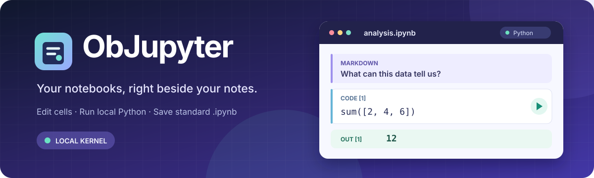

# ObJupyter

<div align="center">
  
  <p><strong>Keep ideas, code, and results together in your knowledge base.</strong></p>
  <p>
    <a href="manifest.json"></a>
    <a href="#getting-started"></a>
    <a href="#getting-started"></a>
    <a href="#features"></a>
    <a href="#support"></a>
  </p>
  <p><a href="README.md">简体中文</a> · <strong>English</strong></p>
  <p><a href="#features">Features</a> · <a href="#getting-started">Getting started</a> · <a href="#support">Support</a></p>
</div>

---

Open, edit, and run Jupyter notebooks in Obsidian. Keep code, Markdown, and results together in a standard `.ipynb` file.

## Features

- Open `.ipynb` files in your vault or create notebooks from the command palette.
- Edit Code, Markdown, and Raw cells; add, delete, move, or change cell types.
- Run a cell or all code cells in order, and interrupt or restart the Python kernel.
- View text, errors, images, and HTML output below cells, with support for `input()` prompts.
- Automatically save edits and results, and preview Markdown cells.
- Set a default Python interpreter or choose one for each notebook.

## Getting started

Open an `.ipynb` file in your vault, choose a local Python interpreter from the toolbar, and click a cell's run button. To set up an environment inside the vault in one click, choose a base Python and click **Set up vault .venv**. The plugin creates `.venv`, installs missing `jupyter_client` and `ipykernel` packages, and selects it for the notebook. An existing usable `.venv` is reused and only missing packages are installed.

For other Python environments, click **Install dependencies** in the environment list. To install manually, click **Copy command** in the missing-dependencies dialog and run it in PowerShell, for example:

```powershell
& 'C:\path\to\python.exe' -m pip install jupyter_client ipykernel
```

After a manual installation, click **Refresh** or **Check again** in the missing-dependencies dialog. Viewing and editing notebooks does not require Python. Running code requires local Python and those packages. The plugin launches your selected interpreter and a kernel in that environment, so run only notebooks you trust.

ObJupyter currently supports **Obsidian Desktop on Windows** and requires Obsidian 1.5.0 or later. Running code requires a local Python environment.

## Installation and license

ObJupyter is not yet listed in the Obsidian Community plugin directory. Once listed, its plugin files can be installed directly from the directory; a Python runtime must still be provided separately. This project is licensed under the [MIT License](LICENSE).

## Support

If ObJupyter is useful to you, you can voluntarily support its continued development and maintenance through WeChat Pay or Alipay. Donations do not unlock features and are not required to use the plugin or report issues.

<details>
<summary> Show payment QR codes</summary>

| WeChat Pay | Alipay |
| :---: | :---: |
|  |  |

</details>
